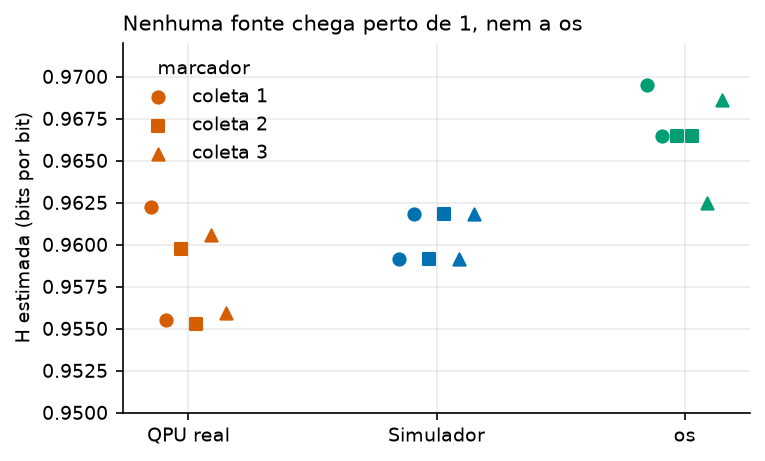
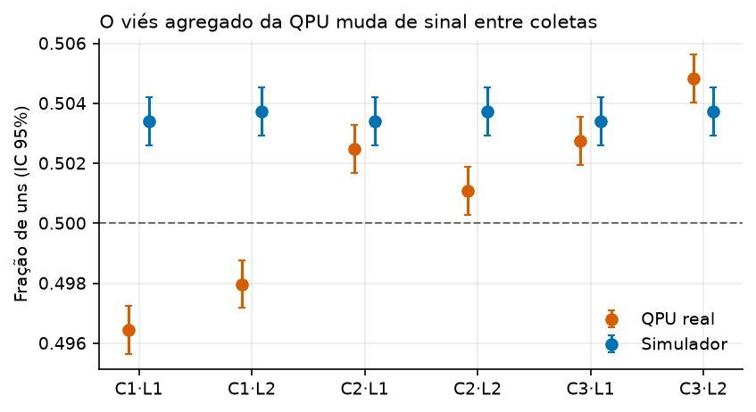
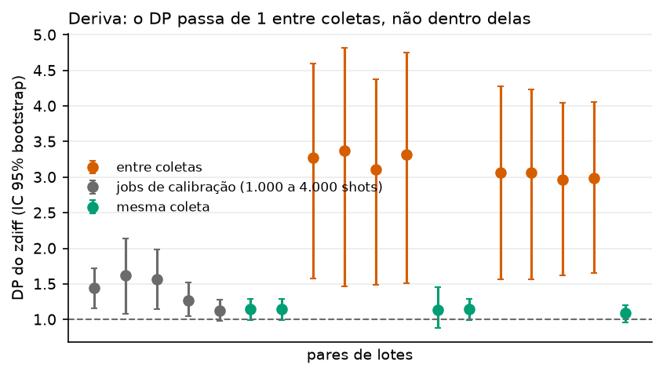
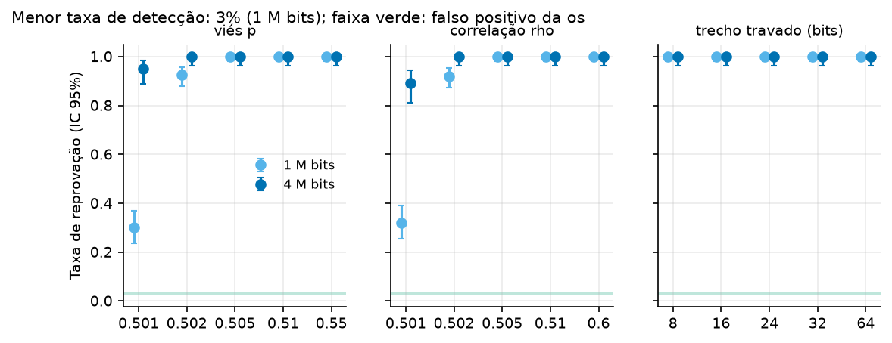
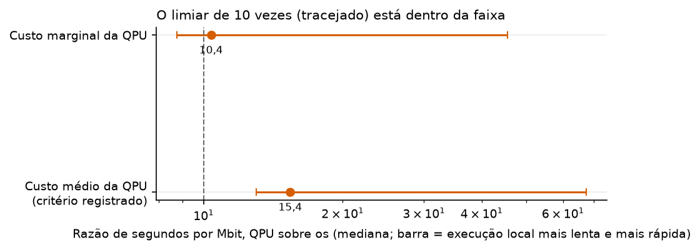
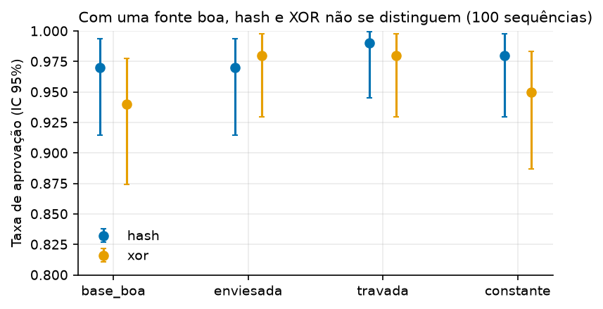
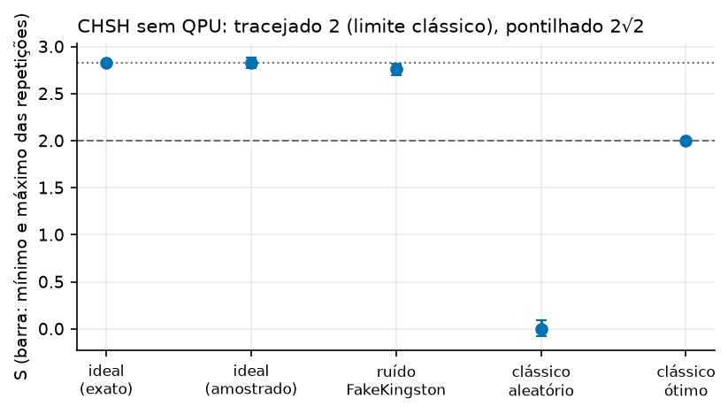

# Entropy Assurance Layer: relatório do projeto

Autor: Bruno Pascual. Protótipo de pesquisa de 9 dias. Gerado por `scripts/gerar_relatorio.py` a partir dos CSVs de `data/results`; nenhum número foi digitado à mão. As faixas de incerteza estão em `data/results/dia8_incerteza.csv`. O texto passou por uma revisão adversarial feita por um revisor independente; a seção 4 registra o que mudou.

## 1. Resumo

A EAL coleta bits de três tipos de fonte (sistema operacional, simulador de QPU com ruído e QPU real da IBM), testa cada lote, mistura só as fontes que não mostraram defeito na saída e emite um recibo assinado com ML-DSA-65, encadeado por hash. Este relatório cobre os cinco experimentos e diz o que os dados sustentam e o que não sustentam.

**Como ler "aprovado".** Aprovado quer dizer que o lote não mostrou defeito nos testes aplicados à saída. Não prova que a fonte é imprevisível, e o provedor da QPU conhece os bits que gerou. A assinatura do recibo garante integridade e ordem, e nada sobre a entropia. A garantia de extração registrada nos recibos depende de a estimativa de H ser um limite verdadeiro de min-entropia, e o estimador supõe bits independentes.

- **QPU real como fonte (E1).** Dos 6 lotes da `ibm_kingston` (3 coletas, 3.000.192 bits por coleta), **nenhum passou** na porta de saúde. A `os` passou em 6 de 6 e o simulador em 0 de 2 lotes distintos (a semente do simulador é fixa e os mesmos 2 lotes reaparecem nas 3 coletas). A causa é o teste de frequência (monobit), que reprova os 6 lotes. O runs reprova 5 deles por pré-requisito (p = 0 quando o monobit falha), então não é uma segunda falha independente, e o lote 2 da coleta 2 reprova só no monobit, por pouco (p = 0,0082). Os 6 lotes passam no critério de min-entropia e no teste de blocos. O viés agregado é pequeno (de 0,4964 a 0,5048 de uns) e com 1,5 milhão de bits ele é medível; **"nenhum passou" descreve o tamanho do lote e o critério escolhido, não prova que a QPU seja de má qualidade**. O sinal do viés mudou entre a coleta 1 e as outras duas.
- **Detecção de fontes ruins (E2).** Viés, correlação e travamento são detectados; o limite é estatístico: o menor viés testado (p = 0,501) é detectado em 30% dos lotes de 1 milhão de bits. Um gerador pseudoaleatório disfarçado **passa** (3% a 4% de reprovação, o nível do falso positivo). O falso positivo na `os` é de 2,6% a 3,6%.
- **Tempo e custo (E3).** A QPU gasta de 10,4 a 15,4 vezes mais segundos por megabit bruto que a `os` (medianas, custo marginal ou médio); com a execução local mais lenta e a mais rápida a razão vai de 8,8 a 67. É uma razão de **tempo**, não de dinheiro: no Open Plan o custo é zero e o custo da `os` não foi valorado. O limiar de 10 vezes **está dentro da faixa**. O custo por megabit útil é indefinido: nenhum lote da QPU foi aprovado.
- **Mistura (E4).** Com uma fonte boa, não há evidência de diferença entre hash e XOR (100 sequências por braço; só diferenças de uns 10 pontos percentuais seriam detectáveis). O XOR entrega a semente escolhida por um adversário que vê a outra fonte; o hash não. Nenhum dos dois protege contra um adversário que testa candidatos: com 2^k tentativas ele força k bits da saída.
- **CHSH (E5).** Só a etapa A, sem QPU: S ideal ≈ 2,83, com o ruído do FakeKingston ≈ 2,76, geradores clássicos ≤ 2. É uma conferência de que o código está certo; **não diz nada sobre a QPU real** nem certifica aleatoriedade.

| Fonte | Lotes aprovados | H estimada (mediana, mín. a máx.) |
|---|---|---|
| QPU real | 0 de 6 (6 distintos) | 0,9578 (0,9553 a 0,9623) |
| Simulador | 0 de 6 (2 distintos) | 0,9605 (0,9592 a 0,9618) |
| os | 6 de 6 (6 distintos) | 0,9665 (0,9625 a 0,9695) |

Estado dos experimentos (gate do Dia 7):

| experimento | estado | ressalva |
|---|---|---|
| E1 | parcial | deriva entre dias medida só contra a coleta 1; coleta 3 contra a coleta 2 não feita |
| E2 | completo | - |
| E3 | completo | custo teórico, sem gasto (Open Plan) |
| E4 | completo | - |
| E5 | parcial | só etapa A, sem QPU; CHSH na QPU real não feito |

## 2. Método e dados

- **Fontes.** `os` (`os.urandom`), `qpu_sim` (Qiskit Aer com o modelo de ruído do FakeKingston, que é um gerador clássico) e `ibm_kingston` (156 qubits, 9.616 shots por job, 1.500.096 bits por lote, Open Plan). Cinco fontes defeituosas simuladas (viés, correlação, travamento, PRNG, replay) servem de adversárias no E2.
- **Coletas.** Três coletas na QPU real, cada uma com 2 jobs (calibração do backend no envio entre parênteses): coleta 1 em 01/11/2026 (11h57); coleta 2 em 01/11/2026 (16h56); coleta 3 em 02/11/2026 (16h36 e 17h14). Mais jobs `cal` menores na coleta 1. As coletas 1 e 2 são do mesmo dia; só a coleta 3 é de outro dia.
- **Testes de saúde por lote.** RCT e APT (SP 800-90B), estimativa de min-entropia (menor entre bit e byte), três testes do SP 800-22 (monobit, frequência por bloco, runs) e detector de replay. Aprovado só se todos passam. Os testes do SP 800-22 funcionam aqui como porta; com lotes de 1,5 milhão de bits a porta reprova vieses de 0,2% a 0,5%.
- **Limites do método.** Os testes olham a saída. Não há alegação de conformidade com SP 800-90B, FIPS 140-3 ou Quantum Origin.

## 3. Resultados

### E1. QPU real contra simulador e `os`



A faixa de H estimada da QPU real (mediana 0,9578, de 0,9553 a 0,9623, mínimo e máximo de 6 lotes, não é IC) fica abaixo da da `os` (mediana 0,9665, de 0,9625 a 0,9695); as faixas mal se separam. O teste de permutação exato dá p = 0,0022, o menor valor possível com 6 contra 6, mas os lotes formam 3 grupos (as 3 coletas) e não 6 observações independentes; trate como indício. Como H aqui é basicamente função do viés, isto repete a falha do monobit e não traz evidência nova. **A H absoluta não mede a qualidade da fonte:** a `os` também fica em 0,9665, porque o estimador é conservador com este tamanho de lote. O simulador (viés, sem correlação entre qubits) fica entre as duas (0,9605).



Os 6 ICs da fração de uns da QPU excluem 0,5, e o sinal muda: **abaixo de 0,5 na coleta 1 e acima nas coletas 2 e 3**, enquanto o simulador fica sempre acima (0,5034). Os ICs são aproximados: tratam os bits como independentes, e os qubits têm vieses diferentes. O IC mais próximo de 0,5 está a 0,0003 dele (lote 2 da coleta 2); entre 6 comparações esse é marginal.



Se só houvesse amostragem binomial, o desvio-padrão (DP) do zdiff por qubit entre dois lotes seria 1. Não é: já nos pares da mesma coleta ele fica em 1,09 a 1,14, e nos pares com um job de calibração do mesmo dia chega a 1,62 (2 a 6 qubits com |z| > 3, contra 0,42 esperado). Há sobredispersão além da binomial até no mesmo dia. **Entre coletas o DP é de 3,0 a 3,4**, mais que o dobro, com 9 a 14 qubits de 156 acima de 3. Os pares entre coletas compartilham jobs, então a evidência independente é de 3 coletas. Os ICs bootstrap (descritivos, não calibrados para uma cauda pesada) são largos, o que sugere que poucos qubits dominam a medida, mas isto não foi testado. As coletas 1 e 2 são do mesmo dia, de modo que a diferença é "entre coletas, com horas a um dia de distância", e não "entre dias". Os dois jobs da coleta 3 têm calibrações diferentes e o DP entre eles é 1,09: neste caso a troca de calibração não aparece. A causa da deriva não foi investigada.

### E2. Detecção de fontes defeituosas



| fonte | n_bits | tipo | n_lotes | n_reprovados | taxa | ic95_inf | ic95_sup |
|---|---|---|---|---|---|---|---|
| faulty_prng | 1.000.000 | deteccao | 200 | 6 | 0,030 | 0,011 | 0,064 |
| faulty_replay | 1.000.000 | referencia | 200 | 4 | 0,020 | 0,005 | 0,050 |
| os | 1.000.000 | falso_positivo | 2000 | 52 | 0,026 | 0,019 | 0,034 |
| faulty_prng | 4.000.000 | deteccao | 100 | 4 | 0,040 | 0,011 | 0,099 |
| faulty_replay | 4.000.000 | referencia | 100 | 0 | 0,000 | 0,000 | 0,036 |
| os | 4.000.000 | falso_positivo | 500 | 18 | 0,036 | 0,021 | 0,056 |

Com 4 milhões de bits o viés de 0,001 sobe de 30% para 95% de detecção. O PRNG com semente fixa passa nos testes porque eles olham só a saída. O falso positivo observado é consistente com o valor aproximado que os alfas dos testes dão (2,97%, supondo 3 testes independentes, o que não é verdade: o runs depende do monobit).

### E3. Vazão e tempo



Custo teórico no Open Plan (sem gasto), com o preço do plano pago registrado no `PROJECT.md`. O critério pré-registrado (tempo médio de QPU por megabit sobre a mediana local) deu 15,4. Com o custo marginal por megabit (2,2456 s/Mbit, contra 3,3331 do custo médio, porque cada job tem um custo fixo) a razão cai para 10,4, e na execução local mais lenta para 8,8. Os segundos de QPU vêm da API em valores inteiros e há só 3 tamanhos de job; a incerteza do ajuste marginal não foi quantificada e é da ordem de 20%. A mediana local cai no grupo lento (6 rápidas e 14 lentas); a causa não foi investigada. O que se sustenta é "da ordem de 10 vezes em tempo", e não "mais de 10 vezes mais caro".

### E4. Resiliência da mistura



Com uma fonte boa não há evidência de diferença entre hash e XOR (Fisher exato, p entre 0,45 e 1,00 nos 4 cenários, 100 sequências por braço; o teste só enxergaria diferenças grandes). "Aprovada" aqui quer dizer que os 3 testes do SP 800-22 passaram sobre 2.000 sementes concatenadas; numa chave real só há uma semente, então a taxa não é propriedade de uma chave. O que separa os dois é o adversário que vê a outra fonte: no XOR a semente final é a que ele escolhe, e os testes **não percebem** (a taxa de aprovação é a mesma de uma semente honesta). No hash nenhuma semente coincidiu com o alvo, o que já era esperado pela construção (probabilidade da ordem de 2^-512) e não é um achado empírico. No cenário `adv_forca` o adversário testa candidatos contra o hash real e força os k primeiros bits da saída em zero com 2^k tentativas, para k = 1, 4, 8, 12, sem nenhuma falha. Esses bits forçados aparecem nos testes populacionais (0 de 10 aprovadas em k = 4, 8 e 12; 8 de 10 em k = 1), mas um adversário que controla poucos bits por semente em uma chave isolada não seria percebido. Cada célula de `adv_forca` tem só 10 sequências, então os ICs são largos (0,44 a 0,97 em k = 1).

### E5. CHSH



| configuracao | n_reps | s_media | s_min | s_max |
|---|---|---|---|---|
| ideal_exato | 1 | 2,828 | 2,828 | 2,828 |
| ideal_amostrado | 100 | 2,829 | 2,770 | 2,885 |
| ruido_fake_kingston | 100 | 2,759 | 2,700 | 2,821 |
| classico_aleatorio | 100 | -0,001 | -0,077 | 0,093 |
| classico_otimo | 100 | 2,000 | 2,000 | 2,000 |

O ideal amostrado passa de 2√2 em alguma repetição por ruído de amostragem, o que não indica violação do limite de Tsirelson. O limite clássico vale por construção nas duas configurações clássicas (o clássico ótimo dá exatamente 2 e o aleatório não informa nada). A faixa "entre 2 e 2√2" para o ruído era uma hipótese pouco restritiva feita antes da rodada, e o resultado foi consistente com ela; o ruído é um retrato fixo da calibração do FakeKingston e não representa o chip hoje. Isto confere que o circuito e a análise estão corretos. **Não mostra não-localidade nem certifica aleatoriedade, e a pergunta "o CHSH ajuda?" não foi respondida para a QPU real.**

## 4. Revisão crítica

Duas revisões: a minha, contra as faixas de incerteza, e a de um revisor independente que recebeu o relatório e os CSVs sem a minha lista. O que não se sustentou foi corrigido neste texto.

| Afirmação ou hipótese | O que a revisão encontrou | Correção |
|---|---|---|
| E3: "muito mais caro que a `os` (razão 15,4 ≥ 10)" | É razão de tempo. Com o custo marginal vale 10,4 e com a máquina mais lenta 8,8, abaixo do limiar. A incerteza do ajuste marginal não foi medida | "Da ordem de 10 vezes em tempo"; o limiar de 10 não separa os casos |
| E1: "H estimada abaixo de 1 na QPU" | A `os` também dá 0,9665: o valor é do estimador. A diferença entre fontes reflete o viés, e os lotes não são independentes | Comparar fontes, com p exato 0,0022 só como indício |
| E1: "viés pequeno mas mensurável na QPU" | Confirmado em cada coleta, mas o sinal muda entre a coleta 1 e as outras | Sem sinal estável; o lote 2 da coleta 2 é marginal |
| E1: "a QPU reprova no monobit e no runs" | O runs reprova 5 lotes por pré-requisito. A QPU passa em min-entropia e em blocos, e o simulador também reprova | Reprovação por monobit, ligada ao tamanho do lote e à porta escolhida |
| E1: "0 de 6 lotes do simulador" | Só 2 lotes distintos (semente fixa) | 0 de 2 lotes distintos |
| E1: "deriva entre dias" | As coletas 1 e 2 são do mesmo dia. O DP já passa de 1 dentro da coleta e até 1,6 com jobs `cal`; o IC bootstrap não é calibrado | "Entre coletas"; sobredispersão também no mesmo dia; causa não investigada; a concentração em poucos qubits é conjetura |
| E4: "hash resiste, XOR é frágil" | Frágil só contra adversário que vê a outra fonte. Sem evidência de diferença na aprovação (n = 100). "Nenhuma semente no alvo" no hash vale por construção. O hash não resiste a quem testa candidatos | Diferença de controle da semente, não de aprovação; k bits de busca forçam k bits |
| E2: "falso positivo de 2,6% a 3,6%" | É consistente com os alfas, mas o valor nominal é uma aproximação (testes dependentes) | "Consistente com"; custo de descartar cerca de 1 lote bom em 30 |
| E5: "ruído entre 2 e 2√2" | Hipótese pouco restritiva, em simulação com ruído fixo; os clássicos valem por construção | Conferência do código; sem conclusão sobre a QPU nem sobre aleatoriedade |
| "Mistura só fontes aprovadas", "recibo assinado" | Passam a ideia de garantia | Aprovado é ausência de defeito na saída; a assinatura é integridade; a extração depende da estimativa de H |

## 5. Limitações

- Protótipo de pesquisa; não usar para proteger dados reais. Bibliotecas PQC em Python puro, sem tempo constante e sem auditoria.
- O provedor da QPU conhece os bits que gerou. CHSH numa QPU em nuvem não é teste de Bell sem brechas.
- Uma QPU (`ibm_kingston`), 3 coletas em 2 dias, 6 lotes. Qualquer afirmação sobre "as QPUs" não se sustenta.
- A QPU nunca foi aprovada pela porta de saúde; por isso nenhum bit dela entrou numa semente e o custo por bit útil não existe.
- O simulador é um gerador clássico, usa semente fixa e trata os qubits como independentes; não reproduz correlação entre vizinhos.
- E1 parcial: a coleta 3 contra a coleta 2 não foi comparada. E5 parcial: só a etapa A.
- Os ICs usam aproximações (bits independentes na fração de uns; 3 testes independentes no falso positivo nominal), e o bootstrap sobre os qubits é descritivo.
- Os testes de saúde não detectam PRNG disfarçado. Isso é um limite de testar só a saída, não um erro do código.
- O tempo de QPU é o cobrado e o local é o tempo de parede do pipeline de uma máquina; não são a mesma moeda.
- A seção 17 do `PROJECT.md` tem as limitações por módulo.

## 6. Como reproduzir

```
py -3.12 -m pip install -r requirements.txt
py -3.12 -m pytest
py -3.12 -m scripts.incerteza_dia8
py -3.12 -m scripts.gerar_relatorio
py -3.12 -m streamlit run dashboard/app.py
```
